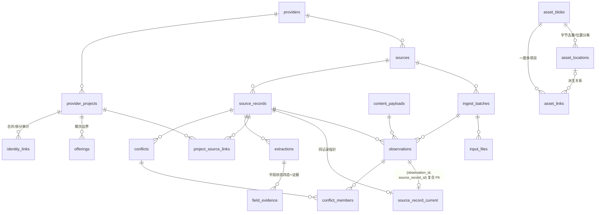

# T03 候选模型与迁移（candidate v1）

- 状态：候选，待独立迁移评审（G-R）。
- 目标 PostgreSQL：16.15（Homebrew），候选集群仅 TCP loopback `127.0.0.1:55441`，unix socket 禁用；数据目录 `candidate_pg/data`（带 `.target_ownership.json` 归属标记，`target_guard` 预检通过见 `evidence/target_check_candidate_pg.json`）。旧端点 `/tmp:55432` 永不连接。
- 契约对应：contract v1 / hash h1（见 `contract.md`）。

## 1. 实体关系（ER，Mermaid）



## 2. 数据字典（关键约束）

| 表 | 关键约束 / 语义 |
| --- | --- |
| providers | `provider_name` UNIQUE |
| sources | `source_code` UNIQUE；`(provider_id, namespace)` UNIQUE —— 集思海外/国内独立 namespace |
| ingest_batches | `batch_id` PK（同 batch_id 不同 digest 物理不可能：PK 冲突）；`capture_mode/coverage` CHECK 枚举；`observed_order` NULL=unknown；触发器 `batch_immutable` 拒绝 UPDATE/DELETE（批次描述不可变） |
| input_files | `(batch_id, relative_path)` UNIQUE |
| source_records | `(source_id, identity_key)` UNIQUE 来源键唯一且非空；`identity_status` confirmed/candidate |
| content_payloads | `(payload_hash, hash_version)` UNIQUE |
| observations | `(batch_id, source_record_id, context_key, payload_id)` UNIQUE 幂等观察键；`order_key` NULL=unknown，ISO-8601 UTC 文本；`(observation_id, source_record_id)` UNIQUE 供同记录指针 FK |
| source_record_current | 复合 FK `(observation_id, source_record_id) → observations` —— 当前指针不能跨记录；`status` ok/conflict/unresolved |
| provider_projects | `(provider_id, native_project_key)` UNIQUE |
| project_source_links | `link_basis` native_id/confirmed/candidate；未确认关系不自动融合 |
| offerings | `(provider_project_id, offering_key)` UNIQUE 期次；日期原文+精度（day/month/year/unknown）；金额 numeric(14,2) 与原文并存；`field_state` 四态 |
| asset_blobs/locations/links | 字节 sha256 去重、位置路径 UNIQUE、业务引用与派生关系分离；一 blob 可多 link |
| extractions / field_evidence | 解析版本；字段原值/规范值/四态/置信度/证据位置/复核状态 |
| manual_overrides（entity_kind, entity_id 为多态引用，DB 级无 FK，非法实体引用由 T09 应用层拒绝并计入 failed）| 人工覆盖层：实体、字段、旧/新值、依据版本、理由、作者、`reverted_by` 可撤销审计 |
| conflicts / conflict_members | 同序冲突成员全部保留 |
| quality_issues / identity_links | P0/P1/P2 质量队列；merge/split 决定审计 |
| schema_migrations | 版本台账（version PK, checksum, applied_at） |
| legacy_id_map / legacy_bridge_status | 旧 ID 映射与桥接对账状态 |

## 3. 迁移序列

| 版本 | 文件 | 内容 |
| --- | --- | --- |
| 0001 | `migrations/0001_candidate_model.sql` | 候选模型 v1 全部表、约束、batch 不可变触发器 |
| 0002 | `migrations/0002_legacy_replica_bridge.sql` | 显式创建 pgcrypto；`legacy_replica` 代表性旧 schema 桥接（无则显式记录 no_legacy_replica_present）；行数对账守卫，不静默丢行 |

- 执行器：`run_migrations.py --database <db> --dry-run`（只读：列出 pending/applied，不写库）与 `--apply`（真正应用）二选一必填；默认迁移目录为脚本旁 `migrations/`。每个迁移与其台账行同一事务；已应用且 checksum 相同 → skip；checksum 不一致 → exit 2（拒绝静默跳过不兼容变更）；SQL 失败 → 整体回滚，台账不动（可恢复检查点=上一已提交版本）。
- 桥接对账（0002）：八类实体行数逐表对账，RAISE 即整体回滚；同名 provider 合并数与 NULL source 批次数显式计入 legacy_bridge_status，不静默丢行。
- 重跑幂等：重复执行 exit 0 且台账不变（`test_rerun_is_noop`）。

## 4. 旧字段保留/转换/弃用（0002 映射）

| 旧实体 → 新表 | 转换 | 弃用/保留说明 |
| --- | --- | --- |
| providers → providers | name 即身份；risk_level/authorization 等列不迁移（权限策略不在首期范围） | 保留于 legacy_replica 只读 |
| sources → sources | source_code=code；provider 由 canonical_projects 关联解析；namespace=旧 code | base_url 等列弃用（记录于 legacy_replica） |
| ingest_batches → ingest_batches | batch_id=batch_code；manifest_digest=sha256(id+stats_json)（pgcrypto）；captured_at=started_at；coverage=unknown、observed_order=NULL（诚实未知）；contract/adapter/mapping/hash_version 标 'legacy'/'legacy-bridge' | stats_json/error_json 保留旧表 |
| source_project_records → source_records | identity_key=contract 编码（`{"native_id":key,"source":code}`，与 contract.py 一致，测试断言） | latest_* 列弃用（投影由 T10 重建） |
| source_project_record_versions → content_payloads + observations | raw_hash→payload_hash(hash_version='legacy')；crawled_at→order_key（UTC ISO 文本）；source_url→evidence_location；context='legacy' | raw_json 冗余正文不迁移（证据定位保留）；A→B→A 三版本全部保留 |
| canonical_projects → provider_projects | native_project_key=旧 uuid；display_title=title | status/readiness 枚举弃用（质量状态走 quality_issues） |
| project_source_links → project_source_links | basis='confirmed' | — |
| project_offerings → offerings | start_date_text+精度（有 date→day，否则 unknown）；price_amount+price_raw 并存；双空→not_provided | staleness_status 弃用 |

## 5. 初始化与恢复说明

```bash
# 初始化（幂等）：初始化数据目录并启动隔离集群
python3 -B pg_candidate.py init
# 建候选库并迁移（示例库名 candidate_main，实际 pilot 库名在 T09 冻结）
python3 -B run_migrations.py --database candidate_main --dry-run  # 只读预览
python3 -B run_migrations.py --database candidate_main --apply      # 真正应用
# 停止 / 销毁（销毁仅作用于 candidate_pg/ 内数据目录）
python3 -B pg_candidate.py stop
python3 -B pg_candidate.py destroy
```

- 恢复检查点：schema_migrations 台账即迁移检查点；任何失败后重跑自动从最后提交版本继续，无需手工清理（失败事务整体回滚）。
- 集群数据目录属于候选目标 `candidate_pg`（target_guard 归属标记 T03）；T12 备份恢复演练在该候选库执行。
